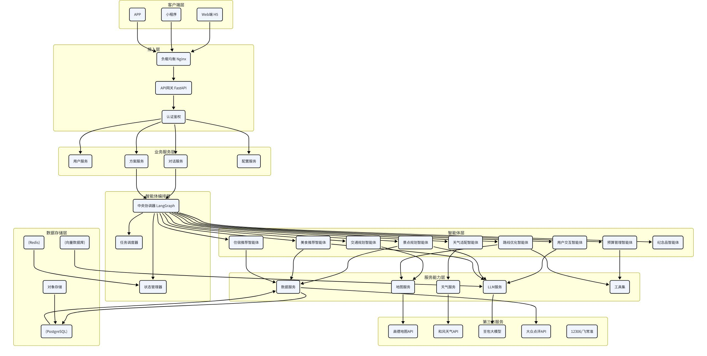

# 二、整体技术架构

## 2.1 系统总体架构图

## 2.2 分层架构说明

系统采用经典的七层分层架构，从下到上依次为：数据存储层、服务能力层、智能体层、智能体编排层、业务服务层、接入层、客户端层。各层职责清晰，通过标准接口通信。

### 第一层：客户端层

面向最终用户的交互入口，支持多种终端形态：

Web端/H5：PC浏览器和移动端浏览器访问，快速触达用户

小程序：微信/支付宝小程序，轻量便捷，适合分享传播

APP：原生APP，提供更完整的功能和更好的体验（V2.0）

### 第二层：接入层

负责流量接入、请求路由、安全防护：

负载均衡：Nginx负责流量分发、SSL卸载、静态资源缓存

API网关：统一接口入口，负责路由、限流、熔断、日志

认证鉴权：统一的身份认证和权限校验

### 第三层：业务服务层

面向业务的服务封装，提供RESTful API：

用户服务：用户注册、登录、个人信息、偏好配置

方案服务：方案生成、查询、修改、导出、分享

对话服务：多轮对话管理、流式输出、消息历史

配置服务：系统配置、字典数据、参数管理

### 第四层：智能体编排层

多智能体系统的核心调度层：

中央协调器：任务拆解、调度分发、冲突协调、结果整合

状态管理器：规划全流程状态管理、上下文维护

任务调度器：并行/串行调度、依赖管理、重试降级

### 第五层：智能体层

各专业领域智能体，负责具体的规划任务：

用户交互智能体、景点规划智能体、交通规划智能体

美食推荐智能体、住宿推荐智能体、天气适配智能体

预算管理智能体、路线优化智能体、纪念品推荐智能体

### 第六层：服务能力层

原子能力封装，为智能体提供基础服务：

LLM服务：大模型调用、Prompt管理、Function Calling

地图服务：地理编码、路径规划、POI搜索、距离计算

天气服务：天气预报、空气质量、生活指数

数据服务：景点、餐厅、酒店等基础数据查询

工具集：通用工具函数、算法库、计算引擎

### 第七层：数据存储层

数据持久化和缓存：

PostgreSQL：结构化业务数据存储

Redis：热点数据缓存、会话状态、限流计数

向量数据库：知识库向量存储、语义检索

对象存储：图片、文件、导出方案等非结构化数据

## 2.3 技术选型总览

系统技术选型覆盖前端、后端、AI、数据库、运维等多个维度，具体选型如下：

| 技术领域 | 技术选型 | 版本 | 选型理由 |
| --- | --- | --- | --- |
| Web框架 | FastAPI | 0.115.x | 异步性能优异、自动生成接口文档、开发效率高、Python生态完善 |
| 多智能体编排 | LangGraph | 0.2.x | 原生支持状态管理、分支判断、循环调度，是最适合复杂多Agent的框架 |
| 大语言模型 | 字节豆包 / 通义千问 | 最新版 | 国内访问稳定、成本低、Function Calling能力完善、中文效果好 |
| 关系数据库 | PostgreSQL | 15.x | 支持JSON字段、地理信息扩展、性能优异、开源免费 |
| 缓存数据库 | Redis | 7.x | 性能极高、数据结构丰富、支持持久化、生态成熟 |
| 向量数据库 | Chroma / Milvus | 最新版 | 轻量易用、支持向量检索、与LangChain生态集成好 |
| ORM框架 | SQLAlchemy | 2.0.x | Python生态最成熟的ORM、支持异步、功能强大 |
| 前端框架 | Vue 3 + Vite | 3.4.x | 性能优异、开发体验好、生态完善、国内使用率高 |
| UI组件库 | Ant Design Vue | 4.x | 组件丰富、设计规范、企业级应用首选 |
| 地图服务 | 高德地图API | 最新版 | 国内数据最准、功能最完善、开发者友好 |
| 天气服务 | 和风天气 | 开发版 | 数据准确、接口稳定、免费额度充足 |
| 容器化 | Docker + Docker Compose | 最新版 | 环境一致性、部署便捷、运维成本低 |
| CI/CD | GitHub Actions / GitLab CI | 最新版 | 配置简单、与代码仓库集成好、免费额度充足 |
| 监控告警 | Prometheus + Grafana | 最新版 | 功能强大、可视化好、生态成熟 |
| 日志系统 | ELK Stack | 最新版 | 日志采集、存储、检索一体化、查询功能强大 |

## 2.4 核心技术决策

在技术选型过程中，我们对多个关键技术点进行了深入对比和评估，最终做出以下核心技术决策：

### 决策1：选择Python + FastAPI作为后端技术栈

备选方案：Java + Spring Boot、Go + Gin

决策理由：

AI生态优势：Python是AI领域的事实标准，LangChain、LangGraph等Agent框架都是Python原生，开发效率最高

开发效率：FastAPI开发速度快，代码量少，适合快速迭代的AI产品

性能够用：异步FastAPI性能完全满足V1.0和V2.0初期的并发需求

团队成本：AI算法工程师普遍熟悉Python，降低团队沟通成本

风险与应对：如果后续并发量大幅增长，可将核心业务拆分为Go微服务，AI部分保留Python。

### 决策2：选择LangGraph作为多智能体编排框架

备选方案：AutoGPT、CrewAI、自研编排

决策理由：

状态管理：LangGraph原生支持有状态的工作流，非常适合规划这种多步骤、多分支的场景

循环与分支：原生支持循环、条件分支、子图，比线性的Agent框架更灵活

生态完善：与LangChain生态无缝集成，工具、模型、向量库都可以直接复用

可观测性：内置追踪和调试能力，便于排查问题

### 决策3：选择国内大模型作为主力模型

备选方案：GPT-4o、Claude 3

决策理由：

合规性：国内模型数据不出境，符合数据安全法规要求

成本优势：国内模型价格远低于GPT-4o，大幅降低推理成本

访问稳定：国内访问速度快，不会有网络波动和限流问题

中文效果：豆包、通义千问等国产模型的中文理解和生成效果已经非常出色

多模型策略：封装统一的LLM接口层，支持模型热切换，不同场景使用不同模型，兼顾效果和成本。

### 决策4：路线优化使用传统算法而非大模型

决策理由：

准确性：TSP问题是经典的算法问题，遗传算法等传统方法可以稳定输出最优解，大模型经常算错

性能：算法计算毫秒级，大模型调用需要几秒到几十秒

成本：算法计算零成本，大模型调用有Token费用

可解释性：算法的计算过程可追溯、可调试，大模型是黑盒

分工原则：精确计算用传统算法，自然语言理解和内容生成用大模型，二者优势互补。

### 决策5：V1.0采用模块化单体架构

备选方案：直接微服务架构

决策理由：

开发速度：单体架构开发部署简单，适合V1.0快速验证产品

运维成本：单体架构运维成本低，小团队也能搞定

预留扩展：按领域划分模块，接口清晰，V2.0可以平滑拆分为微服务

避免过度设计：在业务规模还小的时候，微服务是过度设计，增加复杂度
