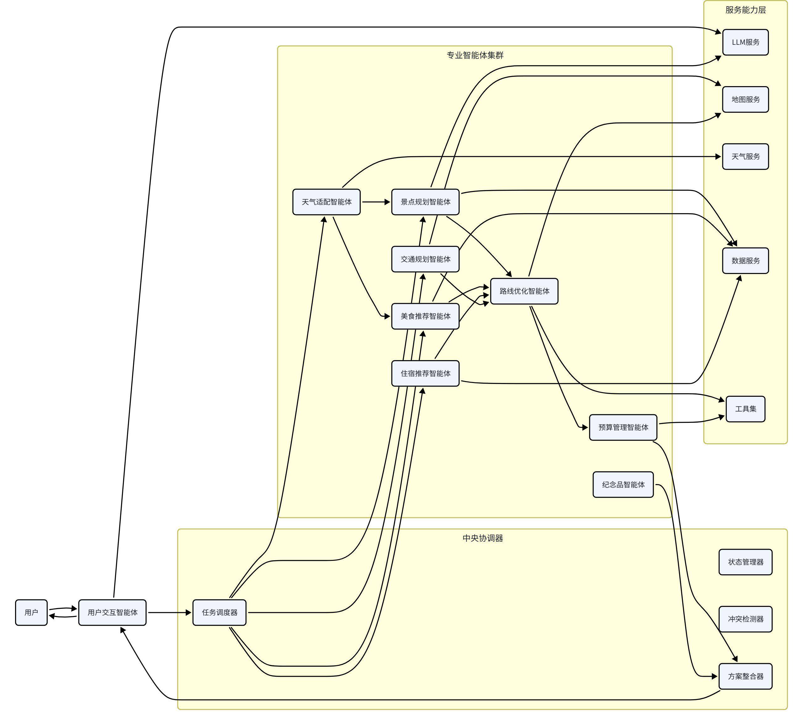
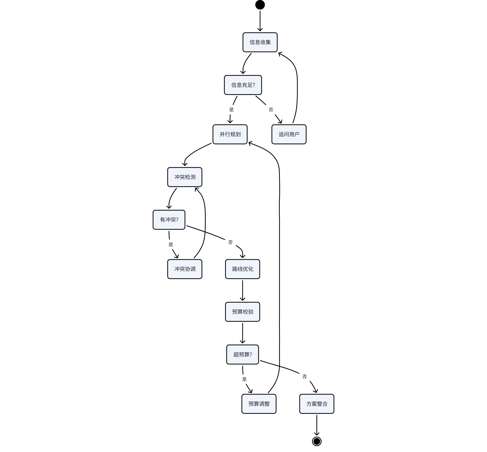
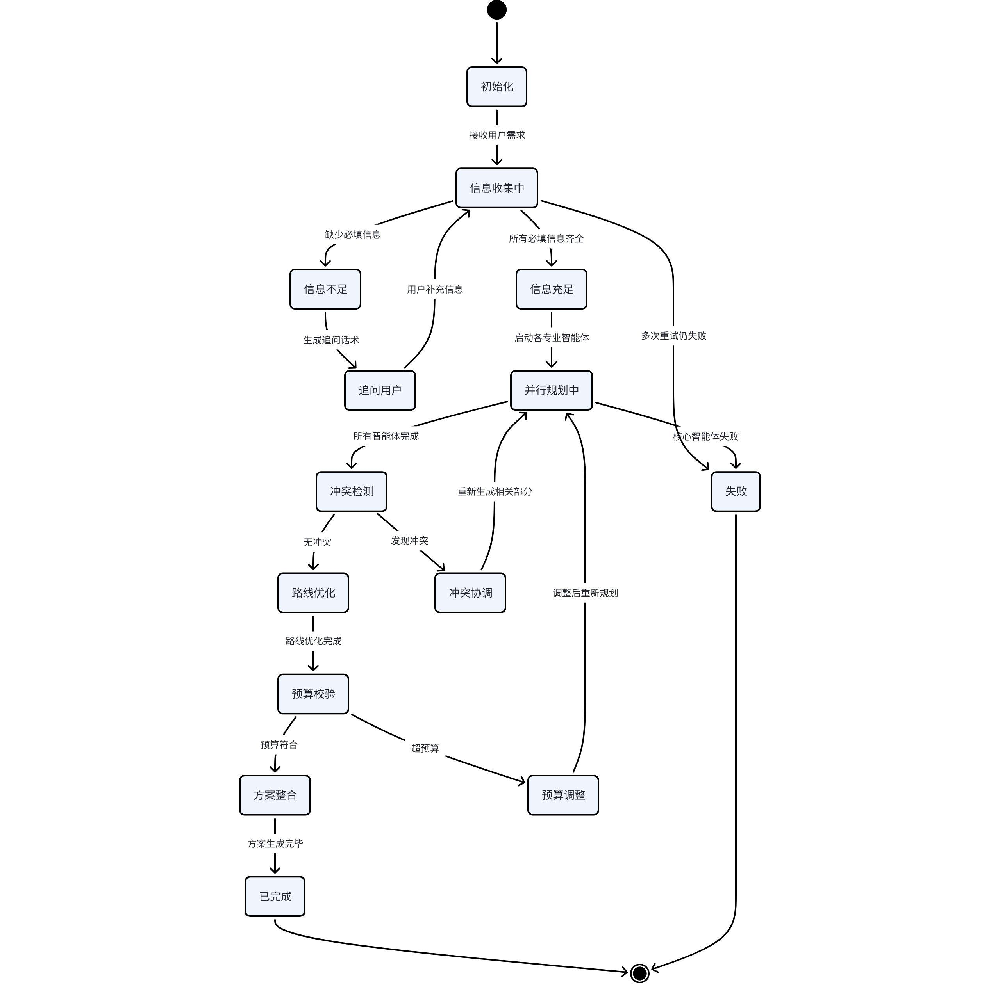

# 四、多智能体架构设计

## 4.1 多智能体架构图



## 4.2 中央协调器设计

中央协调器是多智能体系统的大脑，负责整体规划流程的调度、协调和控制。

### 4.2.1 核心职责

任务拆解：将用户的旅行规划需求，拆解为各专业智能体可执行的子任务

调度分发：根据任务依赖关系，按顺序或并行分发给对应的智能体

状态管理：维护规划全流程的状态和上下文，保证各智能体数据共享

冲突检测：检测各智能体输出结果中的冲突（时间冲突、位置冲突、预算冲突等）

协调优化：发现冲突后，协调相关智能体调整方案，解决冲突

结果整合：将各智能体的输出整合为一份完整的旅行方案

异常处理：智能体失败时的重试、降级、容错处理

### 4.2.2 工作流设计

规划过程分为六个阶段，按顺序执行：



### 4.2.3 核心组件

#### 1. 任务调度器（Task Scheduler）

负责任务的分发和执行控制：

维护任务依赖图，明确各智能体的执行顺序

支持并行调度，无依赖的智能体同时执行，提升效率

支持串行调度，有依赖的智能体按顺序执行

任务超时控制，防止单个智能体卡住整个流程

失败重试机制，智能体失败时自动重试

#### 2. 状态管理器（State Manager）

维护规划全流程的状态数据：

全局上下文管理，所有智能体共享读写

状态版本控制，支持回滚和重试

中间结果持久化，支持断点续传

状态变更事件通知，触发后续动作

#### 3. 冲突检测器（Conflict Detector）

检测各智能体输出之间的冲突：

时间冲突检测：景点游览时间与用餐时间重叠、交通时间不足

位置冲突检测：酒店距离景点群过远、当日行程跨度过大

预算冲突检测：各项费用总和超出用户预算

逻辑冲突检测：推荐的餐厅在推荐时间不营业

#### 4. 方案整合器（Plan Integrator）

将各智能体的输出整合为完整方案：

数据格式标准化，统一各智能体的输出格式

按天组织行程，生成每日行程时间轴

生成方案概览、行程总表、费用明细

自然语言润色，生成可读性强的方案描述

### 4.2.4 容错与降级机制

智能体降级：某个智能体失败时，使用默认值或简化方案替代，不阻塞整体流程

服务降级：第三方API不可用时，使用缓存数据或简化算法

超时控制：每个智能体设置超时时间，超时则视为失败

失败重试：临时性失败自动重试，最多重试3次

熔断机制：某个服务连续失败时，暂时熔断，避免雪崩效应

## 4.3 智能体基类设计

所有智能体都继承自统一的基类，保证接口一致、行为规范。

### 4.3.1 基类设计

```python
智能体基类定义from abc import ABC, abstractmethod
from typing import Dict, Any, List
from langchain_core.tools import BaseTool
from app.agents.context import PlanContext

class BaseAgent(ABC):
"""智能体抽象基类，所有智能体继承此类"""

def __init__(self, name: str, description: str):
self.name = name
self.description = description
self.tools: List[BaseTool] = []  # 该智能体可用的工具列表
self.max_retries: int = 3  # 最大重试次数
self.timeout: int = 60  # 超时时间（秒）

@abstractmethod
async def run(self, context: PlanContext) -> Dict[str, Any]:
"""
智能体核心执行方法
:param context: 全局规划上下文
:return: 本智能体的输出结果，标准化字典格式
"""
pass

def get_tools(self) -> List[BaseTool]:
"""获取智能体可用的工具列表"""
return self.tools

def validate_input(self, context: PlanContext) -> bool:
"""
输入校验，检查上下文是否包含本智能体需要的所有信息
:return: True=校验通过，False=信息不足
"""
return True

def validate_output(self, result: Dict[str, Any]) -> bool:
"""
输出校验，检查结果格式是否正确
:return: True=校验通过，False=格式错误
"""
return True

async def run_with_retry(self, context: PlanContext) -> Dict[str, Any]:
"""带重试的执行方法"""
last_error = None
for i in range(self.max_retries):
try:
# 输入校验
if not self.validate_input(context):
raise ValueError(f"{self.name} 输入信息不足")

# 执行核心逻辑
result = await self.run(context)

# 输出校验
if not self.validate_output(result):
raise ValueError(f"{self.name} 输出格式错误")

return result

except Exception as e:
last_error = e
# 可以在这里加日志和监控

# 重试都失败了，返回降级结果
return self._fallback_result(context, last_error)

def _fallback_result(self, context: PlanContext, error: Exception) -> Dict[str, Any]:
"""降级结果，智能体失败时的兜底方案"""
return {
"success": False,
"error": str(error),
"data": {}
}
```

### 4.3.2 智能体分类

根据职责和实现方式，智能体分为三类：

| 类型 | 特点 | 代表智能体 | 实现方式 |
| --- | --- | --- | --- |
| LLM驱动型 | 核心逻辑依赖大语言模型，处理自然语言理解、内容生成 | 用户交互智能体、景点推荐智能体、美食推荐智能体 | LLM + Prompt + Function Calling |
| 算法驱动型 | 核心逻辑是传统算法，保证精确性和性能 | 路线优化智能体、预算管理智能体 | 传统算法 + 数据结构 |
| 混合型 | 既有算法计算，也有LLM内容生成 | 住宿推荐智能体、天气适配智能体 | 算法筛选 + LLM润色 |

### 4.3.3 工具集设计

智能体通过调用工具来获取外部数据和执行计算。工具统一封装为LangChain的Tool格式。

工具分类：

数据查询类：景点查询、餐厅查询、酒店查询、天气查询

计算类：距离计算、路径规划、预算计算、时间计算

内容生成类：文案润色、摘要生成、推荐理由生成

辅助类：格式转换、数据校验、时间处理

工具设计原则：

单一职责：每个工具只做一件事

输入输出标准化：统一的参数格式和返回格式

异常处理：工具内部处理异常，返回标准化错误

可缓存：查询类工具支持缓存，提升性能

## 4.4 智能体通信机制

### 4.4.1 通信模式

智能体之间采用「共享内存 + 消息通知」的混合通信模式：

共享内存：所有智能体共享同一个全局上下文（PlanContext），可以读取和写入数据

消息通知：智能体完成任务后，通过消息总线通知协调器，协调器触发后续动作

为什么选择这种模式：

简单高效：共享内存模式编程简单，数据共享方便

解耦：通过消息总线通知，智能体之间不直接依赖

可观测：所有数据变更都在上下文中，便于调试和追踪

### 4.4.2 全局上下文（PlanContext）

全局上下文是智能体之间数据共享的核心载体，包含规划过程中的所有状态和数据。

```python
全局上下文数据结构from typing import Dict, List, Optional
from pydantic import BaseModel, Field
from datetime import datetime

class UserProfile(BaseModel):
"""用户画像与偏好"""
people_count: int = 2
crowd_type: str = "情侣"  # 情侣/亲子/独行/朋友/老年
travel_style: str = "经典打卡"
budget_level: str = "舒适性价比"
diet_preference: List[str] = Field(default_factory=list)
food_taboo: List[str] = Field(default_factory=list)
must_visit: List[str] = Field(default_factory=list)
must_eat: List[str] = Field(default_factory=list)
start_time: str = "09:00"
end_time: str = "21:00"
need_nap: bool = False
accommodation_preference: str = "交通便利"

class PlanContext(BaseModel):
"""规划全局上下文，所有智能体共享"""
# 基础信息
session_id: str
user_id: Optional[str] = None
destination: str = ""
departure: str = ""
start_date: str = ""
end_date: str = ""
days: int = 0
total_budget: float = 0

# 用户画像
user_profile: UserProfile = Field(default_factory=UserProfile)

# 各智能体输出结果
weather_data: Dict = Field(default_factory=dict)
attraction_list: List[Dict] = Field(default_factory=list)
traffic_plan: Dict = Field(default_factory=dict)
restaurant_list: List[Dict] = Field(default_factory=list)
hotel_list: List[Dict] = Field(default_factory=list)
budget_detail: Dict = Field(default_factory=dict)
souvenir_list: List[Dict] = Field(default_factory=list)

# 路线优化结果
daily_itinerary: List[Dict] = Field(default_factory=list)

# 最终整合结果
final_plan: Dict = Field(default_factory=dict)

# 状态标记
status: str = "planning"  # planning / info_missing / completed / failed
missing_info: List[str] = Field(default_factory=list)
error_msg: str = ""

# 元数据
created_at: datetime = Field(default_factory=datetime.now)
updated_at: datetime = Field(default_factory=datetime.now)
retry_count: int = 0
```

### 4.4.3 消息总线

消息总线用于智能体与协调器之间的事件通知，实现解耦。

核心消息类型：

agent_started：智能体开始执行

agent_completed：智能体执行完成

agent_failed：智能体执行失败

context_updated：上下文数据更新

conflict_detected：检测到冲突

plan_completed：规划完成

消息处理流程：

智能体执行完成后，发布 agent_completed 消息

协调器收到消息，更新状态，检查是否所有依赖任务都完成

所有依赖完成后，触发下一个阶段的智能体执行

### 4.4.4 数据流转规范

读写原则：每个智能体只能写入自己负责的字段，读取其他智能体的字段

版本控制：上下文每次更新都增加版本号，防止并发冲突

数据校验：写入数据前必须校验格式，保证数据质量

变更日志：记录所有数据变更，便于回溯和调试

## 4.5 状态管理设计

### 4.5.1 状态机设计

规划过程采用状态机管理，每个状态有明确的进入条件、退出条件和转换规则。



### 4.5.2 状态持久化

规划状态需要持久化存储，支持断点续传和异常恢复。

存储方案：

Redis：活跃会话的状态存在Redis中，读写快，设置过期时间

PostgreSQL：已完成的方案持久化到数据库，长期保存

双写策略：状态变更同时写入Redis和数据库，保证数据安全

持久化时机：

每个阶段完成后持久化一次

关键数据变更后立即持久化

智能体失败后持久化错误信息

### 4.5.3 并发控制

防止同一个会话同时执行多个规划任务，导致数据混乱。

分布式锁方案：

使用Redis分布式锁，每个会话同一时间只能有一个规划任务在执行

锁超时时间设置为最长规划时间的2倍，防止死锁

获取锁失败时，返回「正在规划中」的提示

### 4.5.4 状态恢复

系统重启或故障后，能够恢复未完成的规划任务。

恢复策略：

系统启动时，扫描Redis中未完成的会话

根据当前状态，决定是重新执行还是继续执行

对于执行到一半的任务，回滚到上一个稳定状态后重试

恢复失败的会话，标记为失败并通知用户

## 4.6 各智能体详细设计

### 4.6.1 用户交互智能体

职责：负责与用户的自然语言交互，解析用户需求，判断信息是否完整，生成追问话术。

类型：LLM驱动型

核心能力：

需求解析：将用户自然语言转化为结构化的需求参数

缺失信息判断：对照必填信息清单，判断哪些信息缺失

智能追问：信息不足时，生成自然口语化的追问话术

修改意图识别：识别用户修改方案的意图，如「换个酒店」「去掉这个景点」

多轮对话管理：维护对话历史，理解上下文

输入输出：

输入：用户消息、对话历史、当前上下文

输出：结构化需求参数、是否需要追问、追问话术

### 4.6.2 景点规划智能体

职责：负责景点筛选、推荐排序、游览时长估算、最佳游览时段推荐。

类型：混合型（数据筛选 + LLM润色）

核心能力：

景点筛选：根据城市、标签、预算、人群等条件筛选景点

推荐排序：综合评分、知名度、匹配度、性价比排序

分级打标：必去经典、强烈推荐、值得一去、小众宝藏

时长估算：根据景点规模和类型估算游览时长

最佳时段：推荐最佳游览时段，避开人流高峰

避坑过滤：过滤差评多、宰客严重的景点

内容润色：用LLM生成景点介绍、亮点、贴士

核心算法：综合评分算法 = 知名度×0.3 + 用户评分×0.25 + 匹配度×0.25 + 性价比×0.2

### 4.6.3 交通规划智能体

职责：负责大交通方案规划、市内交通方案规划、交通费用估算。

类型：混合型（API数据 + 算法计算）

核心能力：

大交通方案：往返航班/火车查询，生成时间最短、价格最低、舒适最优三套方案

换乘方案：无直达时自动计算最优换乘方案

市内交通：景点间路径规划，支持步行、公交、地铁、打车

交通推荐：根据用户偏好推荐最优交通方式

时间缓冲：交通时间预留缓冲，避免卡得太死

费用估算：交通费用明细计算

### 4.6.4 美食推荐智能体

职责：负责餐厅推荐、用餐安排、美食汇总。

类型：混合型（数据筛选 + 顺路算法 + LLM润色）

核心能力：

餐厅筛选：根据口味、预算、菜系、评分筛选餐厅

顺路优先：餐厅优先选在当日景点路线沿途，不绕路

错峰安排：正餐避开高峰时段

用餐分配：按早餐、午餐、晚餐、下午茶合理分配

本地特色：优先推荐本地特色餐厅和老字号

避坑过滤：过滤网红炒作、宰客严重的餐厅

菜品推荐：每家餐厅推荐招牌菜和必点菜

### 4.6.5 住宿推荐智能体

职责：负责酒店选址优化、酒店筛选推荐、性价比评估。

类型：混合型（选址算法 + 数据筛选）

核心能力：

选址优化：计算景点地理中心，优先推荐中心区域酒店

交通便利：叠加地铁、公交便利性评分

分级推荐：经济型、舒适型、高档型三个档位各推荐2-3家

性价比评分：综合价格、评分、位置、设施计算性价比

换酒店评估：多区域行程时，评估是否需要换酒店

隐性成本提示：提示是否含早、服务费、停车费等

选址算法：计算所有景点的经纬度中心点，按距离中心点远近 + 交通便利性加权评分

### 4.6.6 天气适配智能体

职责：负责天气查询、天气对行程的影响评估、行程调整建议。

类型：混合型（API数据 + 规则引擎）

核心能力：

天气预报：获取行程期间逐日、逐小时天气预报

影响评估：评估天气对各景点的影响程度

行程调整：雨天增加室内景点，高温调整户外时段

穿搭建议：根据天气推荐穿搭方案

物品提醒：提醒带伞、防晒、保暖等物品

天气适配规则：

雨天：户外景点占比降低30%，增加博物馆、商场等室内景点

高温（≥35℃）：正午12:00-15:00安排室内活动或午休

大风/雾霾：取消登高、观景类景点

低温：增加室内和运动类景点，减少户外停留时间

### 4.6.7 预算管理智能体

职责：负责费用估算、预算分配、超支检测、预算调整建议。

类型：算法驱动型

核心能力：

费用估算：按交通、住宿、餐饮、门票、市内交通、其他六大类逐项估算

预算分配：根据用户偏好自动分配预算比例

超支检测：汇总所有费用，检测是否超出总预算

调整建议：超支时给出具体的降本方案

费用明细：生成详细的费用明细表和人均费用

多档位对比：经济型、舒适型、豪华型三档预算对比

### 4.6.8 路线优化智能体

职责：负责每日行程路线优化、时间衔接校验、行程松紧度调节。

类型：算法驱动型（核心质量模块）

核心能力：

TSP优化：求解旅行商问题，计算最优游览顺序，减少折返

时间衔接：检查每个节点的时间衔接是否合理

松紧度调节：根据用户偏好调整景点密度和休息时间

用餐插入：在合适的时间点插入用餐和休息

交通计算：计算景点间交通时间和费用

核心算法：

景点数量≤10：动态规划精确求解

景点数量>10：遗传算法求近似最优解

适应度函数：总路程×0.6 + 时间合理性×0.3 + 顺路度×0.1

### 4.6.9 纪念品推荐智能体

职责：负责纪念品推荐、购买地点规划、避坑提示。

类型：数据驱动型

核心能力：

纪念品推荐：分类推荐当地特色纪念品和特产

购买规划：推荐最佳购买地点和时机

价格参考：提供参考价格，防止被宰

避坑提示：常见旅游购物陷阱提醒

携带建议：保质期、体积、重量等实用建议
