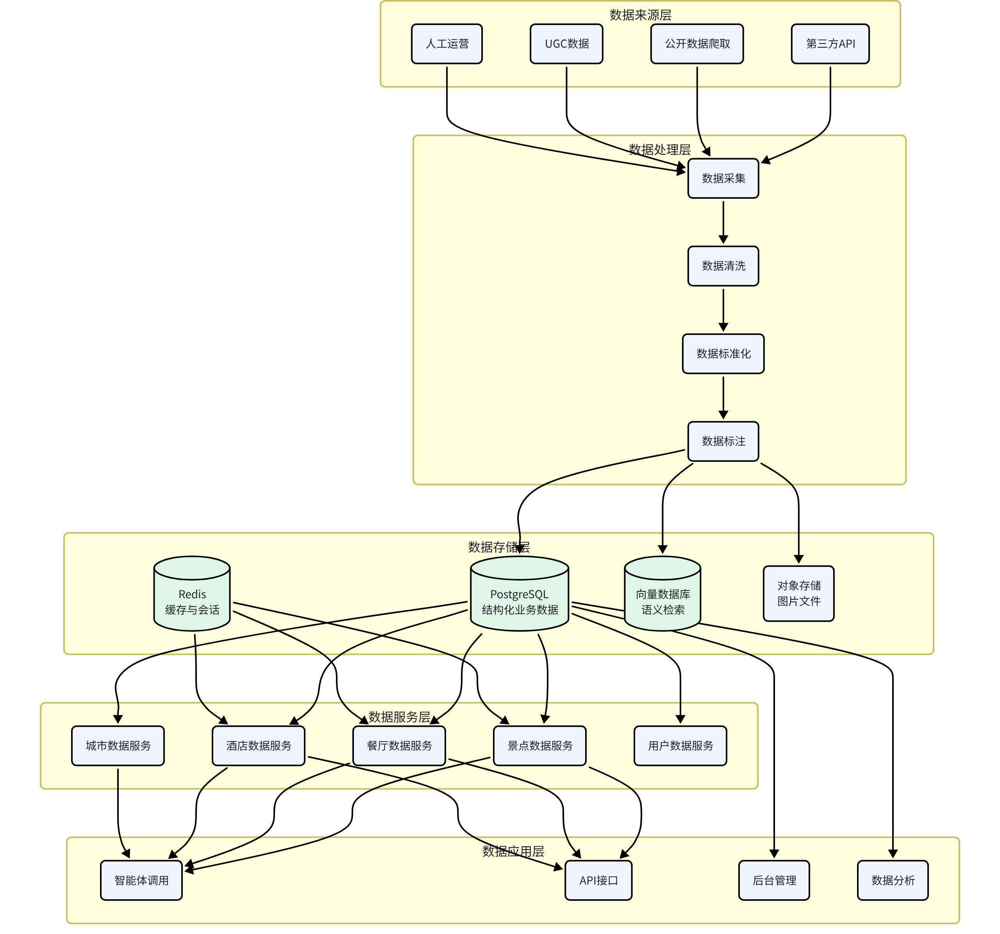
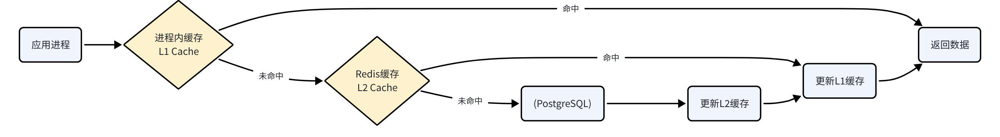
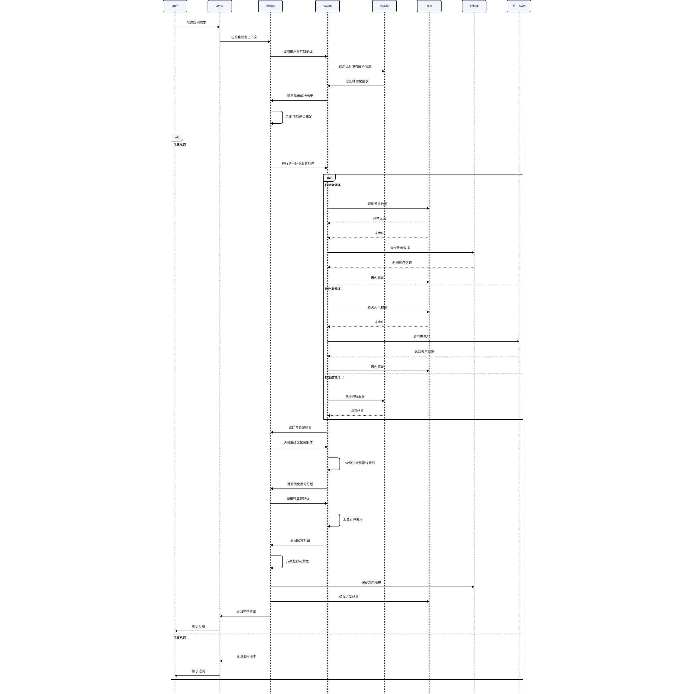

# 五、数据架构设计

## 5.1 数据架构总览

数据架构采用经典的五层设计：数据来源层 → 数据处理层 → 数据存储层 → 数据服务层 → 数据应用层。各层职责清晰，数据单向流动，保证数据质量和可维护性。

## 5.2 数据库设计

数据库表结构、字段说明、约束、索引和删除策略以 [数据库设计文档](../database/数据库设计文档.md) 为准。

本章不重复表级明细，只保留面向系统设计的原则说明。任何新增表或字段，应优先同步更新数据库设计文档，再回填到 ORM 和迁移脚本。

## 5.3 缓存设计

采用多级缓存策略，从快到慢依次为：进程内缓存 → Redis 分布式缓存 → 数据库。

### 5.3.1 缓存分类与策略

| 缓存类型 | 存储位置 | 缓存内容 | 过期时间 | 更新策略 |
| --- | --- | --- | --- | --- |
| 基础数据缓存 | Redis | 景点、餐厅、酒店、城市字典 | 24小时 | 定时批量更新 |
| 会话状态缓存 | Redis | 用户会话、规划上下文 | 7天 | 用户活跃自动续期 |
| 方案结果缓存 | Redis + DB | 生成的旅行方案 | 30天 | 用户修改时更新 |
| API结果缓存 | Redis | 第三方API调用结果 | 按API特性 | 过期自动刷新 |
| 热点数据缓存 | 进程内 | 高频访问的配置、字典 | 5分钟 | 定时刷新 |
| 限流计数缓存 | Redis | 接口限流、频次统计 | 按时间窗口 | 自动过期 |

### 5.3.2 缓存键设计

统一的缓存键命名规范，便于管理和排查问题。

命名格式：业务域:数据类型:唯一标识

示例：

attraction:detail:12345 - 景点详情

attraction:list:changsha - 长沙景点列表

plan:session:abc123 - 会话规划状态

user:profile:67890 - 用户配置

weather:forecast:430100 - 长沙天气预报

### 5.3.3 缓存更新策略

Cache Aside 模式：读时先读缓存，未命中读数据库再写缓存；写时先写数据库再删缓存

定时刷新：基础数据每天凌晨批量刷新，保证数据新鲜度

主动失效：后台修改数据后，主动删除对应缓存

缓存预热：系统启动时，预加载热门城市的基础数据

### 5.3.4 缓存问题处理

缓存穿透：布隆过滤器 + 空值缓存，防止恶意请求穿透到数据库

缓存击穿：互斥锁 + 热点数据永不过期，防止热点key失效瞬间大量请求打到数据库

缓存雪崩：过期时间加随机值，防止大量key同时失效

## 5.4 数据流转设计

### 5.4.1 方案生成数据流

用户请求生成旅行方案时，数据在各层之间的流转过程：

### 5.4.2 数据流向原则

单向流动：数据从底层往上层流动，上层不直接操作底层数据

服务封装：所有数据访问都通过服务层封装，不直接操作数据库

缓存优先：能走缓存的先走缓存，减少数据库和API压力

异步处理：非实时性的数据更新，采用异步处理，不阻塞主流程

### 5.4.3 数据一致性保证

事务保证：核心业务操作使用数据库事务，保证数据一致性

最终一致：缓存与数据库之间采用最终一致性模型，允许短暂不一致

幂等设计：所有写操作都设计为幂等，重复执行不影响结果

补偿机制：数据更新失败时，有重试和补偿机制

## 5.5 数据同步策略

### 5.5.1 基础数据同步

景点、餐厅、酒店等基础数据需要定期从第三方同步，保证数据的准确性和时效性。

同步策略：

全量同步：每月一次全量同步，全量拉取数据，清洗后入库

增量同步：每天一次增量同步，只同步变更的数据

实时同步：价格、库存等实时变化的数据，用户查询时实时调用API

同步流程：

从第三方API拉取原始数据

数据清洗：去重、格式统一、异常数据过滤

数据标准化：统一字段命名、单位、格式

数据丰富：补充标签、评分、推荐等级等

数据校验：校验数据完整性和合理性

入库更新：更新数据库，同时失效缓存

### 5.5.2 缓存数据同步

被动失效：数据更新时，主动删除对应缓存，下次查询时重新加载

主动刷新：定时任务定期刷新热点数据缓存

预热加载：系统启动时，预加载热门城市的基础数据

### 5.5.3 多数据源融合

同一数据可能有多个来源，需要进行融合处理，取最优值。

融合策略：

优先级策略：不同数据源设置不同优先级，高优先级的数据覆盖低优先级

投票策略：多个数据源的数据进行对比，取多数一致的

加权平均：数值型数据按可信度加权平均

人工审核：关键数据不一致时，人工审核确认

### 5.5.4 数据质量监控

完整性监控：监控关键字段的缺失率，超过阈值告警

准确性监控：抽样校验数据准确性，与官方数据对比

时效性监控：监控数据更新时间，超过有效期告警

一致性监控：监控缓存与数据库的一致性

### 5.5.5 数据版本管理

历史版本：重要数据保留历史版本，支持回溯

变更日志：记录所有数据变更，便于审计和排查

回滚机制：数据更新出问题时，支持快速回滚到上一版本
