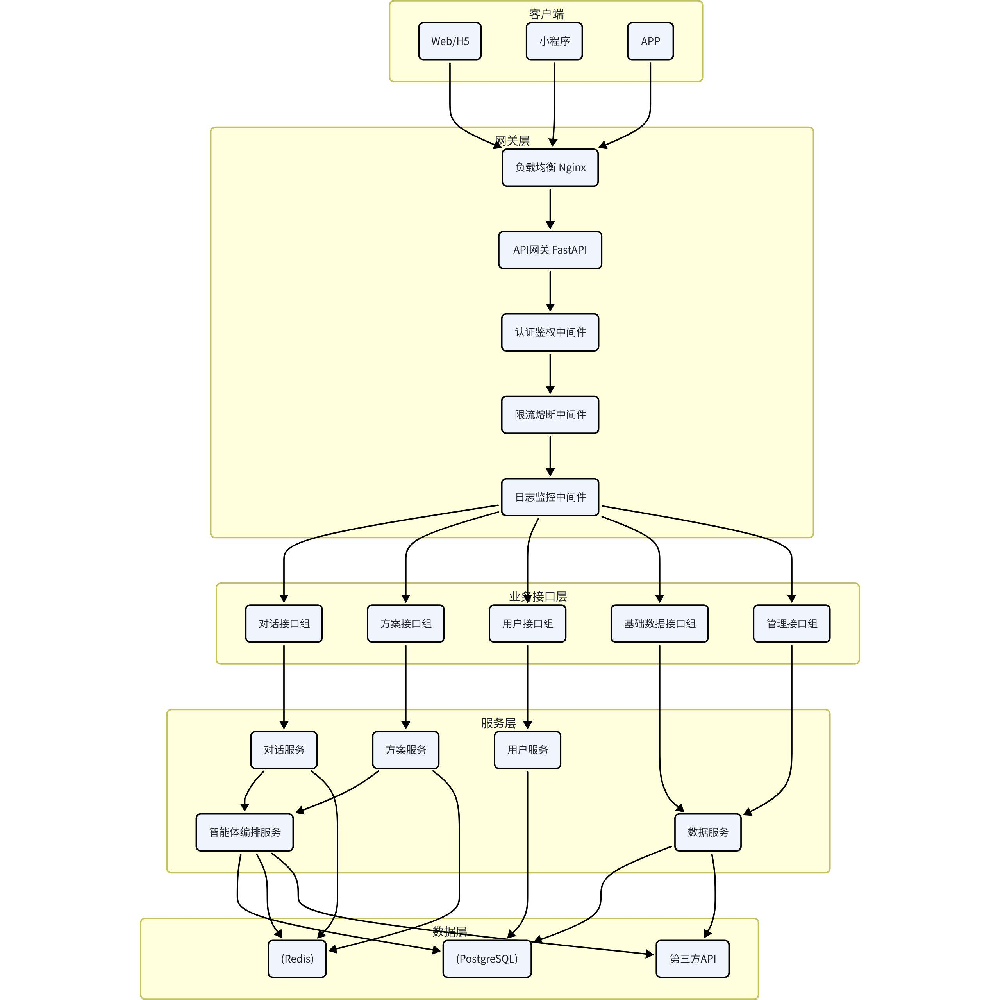

# 六、API接口设计

## 6.1 API设计原则

### 6.1.1 RESTful设计规范

- 接口围绕资源设计，使用名词而非动词。
- HTTP 方法语义保持固定：`GET` 查询、`POST` 创建或触发非幂等任务、`PUT/PATCH` 更新、`DELETE` 删除。
- URL 使用小写复数资源名和连字符，版本前缀固定为 `/api/v1/`。
- 详细接口定义与字段约束与 `docs/api/API接口规范文档.md` 保持一致；本节仅保留架构总览。

### 6.1.2 接口设计原则

- 列表接口统一支持 `page`、`page_size`、`sort_by`、`sort_order` 和必要筛选参数。
- 耗时任务优先采用异步任务或 SSE 流式输出。
- 统一响应格式使用 `code`、`message`、`data`、`request_id`。
- 错误信息不得暴露堆栈、SQL、密钥或第三方原始错误。

### 6.1.3 接口性能原则

- 按需返回，支持字段筛选。
- 合理使用资源嵌套，避免过深层级。
- 对于频繁查询或批量操作场景，优先补充批量接口或分页接口。

## 6.2 接口分层架构

API 接口采用分层设计，从外到内依次为：网关层 -> 业务接口层 -> 服务层 -> 数据层。



### 6.2.1 网关层职责

- 路由转发：根据 URL 路径转发到对应的业务接口。
- 认证鉴权：统一的 Token 校验和权限判断。
- 限流熔断：接口限流、服务熔断、降级处理。
- 日志监控：请求日志、响应时间统计、异常监控。
- 跨域处理：CORS 跨域请求处理。
- 请求校验：参数格式校验、签名校验。

### 6.2.2 业务接口层

按业务领域划分接口组，每组接口负责一个业务领域。

| 接口组 | 前缀 | 职责 | 鉴权要求 |
| --- | --- | --- | --- |
| 对话接口组 | /api/v1/chat | 对话交互、流式输出、消息历史 | 需要 |
| 方案接口组 | /api/v1/plans | 方案生成、查询、修改、导出、分享 | 需要 |
| 用户接口组 | /api/v1/user | 用户信息、偏好配置、匿名会话合并 | 需要 |
| 基础数据接口组 | /api/v1/data | 景点、餐厅、酒店、城市、天气等基础数据查询 | 可选 |
| 认证接口组 | /api/v1/auth | 登录、短信验证码、Token 刷新、登出 | 不需要 |
| 运维接口组 | /api/v1/health, /api/v1/tasks | 健康检查、任务查询 | 管理或内部 |

## 6.3 核心接口清单

### 6.3.1 认证接口

| 接口 | 方法 | 路径 | 说明 |
| --- | --- | --- | --- |
| 发送短信验证码 | POST | /api/v1/auth/sms-codes | 发送短信验证码 |
| 手机号验证码登录 | POST | /api/v1/auth/sessions | 创建登录会话 |
| 刷新 Token | POST | /api/v1/auth/tokens | 刷新访问令牌 |
| 登出 | DELETE | /api/v1/auth/sessions/current | 退出当前登录会话 |

### 6.3.2 用户接口

| 接口 | 方法 | 路径 | 说明 |
| --- | --- | --- | --- |
| 用户资料 | GET | /api/v1/user/profile | 获取用户基本信息 |
| 更新资料 | PUT | /api/v1/user/profile | 更新用户基本信息 |
| 偏好配置 | GET | /api/v1/user/preferences | 获取用户旅行偏好配置 |
| 更新偏好 | PUT | /api/v1/user/preferences | 更新用户旅行偏好配置 |
| 匿名数据合并 | POST | /api/v1/user/sessions/anonymous/merge | 登录后合并匿名会话数据 |

### 6.3.3 对话接口

| 接口 | 方法 | 路径 | 说明 |
| --- | --- | --- | --- |
| 创建会话 | POST | /api/v1/chat/sessions | 创建新的对话会话 |
| 会话列表 | GET | /api/v1/chat/sessions | 获取用户会话列表 |
| 删除会话 | DELETE | /api/v1/chat/sessions/{sessionId} | 删除指定会话 |
| 发送消息 | POST | /api/v1/chat/sessions/{sessionId}/messages | 发送用户消息，返回 SSE 流 |
| 流式连接 | GET | /api/v1/chat/sessions/{sessionId}/stream | SSE 断点续传连接 |
| 消息历史 | GET | /api/v1/chat/sessions/{sessionId}/messages | 获取消息历史 |

### 6.3.4 方案接口

| 接口 | 方法 | 路径 | 说明 |
| --- | --- | --- | --- |
| 方案列表 | GET | /api/v1/plans | 获取用户的方案列表 |
| 方案生成 | POST | /api/v1/plans | 触发方案生成 |
| 方案详情 | GET | /api/v1/plans/{planId} | 获取单个方案详情 |
| 局部修改 | PATCH | /api/v1/plans/{planId} | 局部修改方案内容 |
| 重新生成 | POST | /api/v1/plans/{planId}/generations | 重新生成方案 |
| 删除方案 | DELETE | /api/v1/plans/{planId} | 删除方案 |
| 导出方案 | POST | /api/v1/plans/{planId}/exports | 导出方案 |
| 分享方案 | POST | /api/v1/plans/{planId}/shares | 生成分享链接 |
| 收藏方案 | POST | /api/v1/plans/{planId}/favorites | 收藏或取消收藏方案 |

### 6.3.5 基础数据接口

| 接口 | 方法 | 路径 | 说明 |
| --- | --- | --- | --- |
| 热门城市 | GET | /api/v1/data/cities?popular=true | 获取热门城市列表 |
| 城市搜索 | GET | /api/v1/data/cities?keyword=xxx | 搜索城市 |
| 景点列表 | GET | /api/v1/data/attractions | 获取景点列表 |
| 景点详情 | GET | /api/v1/data/attractions/{id} | 获取景点详情 |
| 餐厅列表 | GET | /api/v1/data/restaurants | 获取餐厅列表 |
| 酒店列表 | GET | /api/v1/data/hotels | 获取酒店列表 |
| 天气查询 | GET | /api/v1/data/weather | 获取天气信息 |

### 6.3.6 运维与元信息接口

| 接口 | 方法 | 路径 | 说明 |
| --- | --- | --- | --- |
| 健康检查 | GET | /api/v1/health | 服务健康状态 |
| 任务查询 | GET | /api/v1/tasks/{taskId} | 查询异步任务状态 |

## 6.4 数据格式规范

### 6.4.1 统一响应格式

```json
{
  "code": 0,
  "message": "ok",
  "data": {},
  "request_id": "req_abc123def456"
}
```

| 字段 | 类型 | 说明 |
| --- | --- | --- |
| `code` | int | `0` 表示成功，非 `0` 表示业务错误 |
| `message` | string | 成功为 `ok`，失败为错误描述 |
| `data` | object/array/null | 响应数据 |
| `request_id` | string | 请求唯一标识 |

### 6.4.2 分页响应格式

```json
{
  "code": 0,
  "message": "ok",
  "data": {
    "list": [],
    "total": 100,
    "page": 1,
    "page_size": 20,
    "total_pages": 5
  },
  "request_id": "req_abc123def456"
}
```

分页请求参数统一为 `page`、`page_size`、`sort_by`、`sort_order`，其中 `page` 从 1 开始，`page_size` 默认 20、最大 100。

### 6.4.3 游标翻页

消息历史等实时追加场景可在分页参数之外补充 `before_id`、`after_id`、`limit`。

### 6.4.4 SSE 流式响应

耗时任务统一采用 SSE，事件类型为 `message`、`progress`、`step_start`、`step_end`、`done`、`error`。

重连时使用 `Last-Event-ID`，服务端每 30 秒发送 `: keepalive` 维持连接。

## 6.5 错误码设计

### 6.5.1 HTTP 状态码

| 状态码 | 含义 |
| --- | --- |
| 200 | 成功 |
| 201 | 已创建 |
| 400 | 请求参数错误 |
| 401 | 未认证 |
| 403 | 无权限 |
| 404 | 资源不存在 |
| 429 | 请求过多 |
| 500 | 服务器内部错误 |
| 502 | 网关错误 |
| 503 | 服务不可用 |
| 504 | 网关超时 |

### 6.5.2 业务错误码

| 错误码区间 | 含义 |
| --- | --- |
| 10000-19999 | 通用错误 |
| 20000-29999 | 认证错误 |
| 30000-39999 | 用户错误 |
| 40000-49999 | 方案错误 |
| 50000-59999 | 对话错误 |
| 60000-69999 | 第三方服务错误 |
| 70000-79999 | 任务错误 |

### 6.5.3 错误响应示例

```json
{
  "code": 40001,
  "message": "方案不存在",
  "data": null,
  "request_id": "req_abc123def456"
}
```
