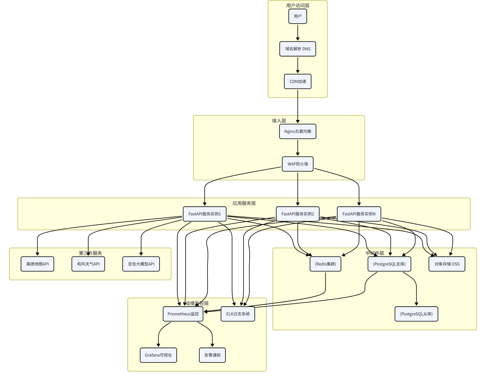

# 七、部署架构设计

## 7.1 部署架构图



## 7.2 环境规划

### 7.2.1 环境划分

系统划分为四个环境，各环境相互隔离，用途不同。

| 环境 | 用途 | 数据 | 访问权限 |
| --- | --- | --- | --- |
| 开发环境（dev） | 开发人员日常开发调试 | 模拟数据 | 开发团队 |
| 测试环境（test） | 测试人员功能测试、集成测试 | 测试数据 | 开发+测试团队 |
| 预发布环境（staging） | 上线前验证，与生产环境配置一致 | 生产数据脱敏 | 核心团队 |
| 生产环境（prod） | 正式对外提供服务 | 真实用户数据 | 运维+管理员 |

### 7.2.2 环境配置管理

配置隔离：每个环境有独立的配置文件，不混用

环境变量：敏感配置通过环境变量注入，不硬编码在代码中

配置中心：使用配置中心统一管理配置，支持热更新

配置版本：配置文件纳入版本管理，变更可追溯

### 7.2.3 资源规划（初期）

| 服务 | 开发环境 | 测试环境 | 生产环境 |
| --- | --- | --- | --- |
| 应用服务器 | 1台 2核4G | 2台 2核4G | 4台 4核8G |
| Redis | 单节点 1G | 主从 2G | 集群 8G |
| PostgreSQL | 单节点 20G | 主从 50G | 主从+只读 200G |
| 对象存储 | 10G | 50G | 500G |
| 监控服务 | 共享 | 共享 | 独立 2核4G |

## 7.3 容器化部署

### 7.3.1 容器化方案

所有服务都采用Docker容器化部署，保证环境一致性。

Docker镜像构建：

使用多阶段构建，减小镜像体积

基础镜像使用官方Python slim镜像

依赖分层缓存，加快构建速度

镜像版本与代码版本一一对应

Dockerfile示例

```dockerfile
# 构建阶段
FROM python:3.12-slim AS builder

WORKDIR /app
COPY requirements.txt .
RUN pip install --no-cache-dir -r requirements.txt

# 运行阶段
FROM python:3.12-slim

WORKDIR /app
COPY --from=builder /usr/local/lib/python3.12/site-packages /usr/local/lib/python3.12/site-packages
COPY --from=builder /usr/local/bin /usr/local/bin

COPY . .

EXPOSE 8000
CMD ["uvicorn", "main:app", "--host", "0.0.0.0", "--port", "8000", "--workers", "4"]
```

### 7.3.2 Docker Compose编排

开发和测试环境使用Docker Compose编排，一键启动所有服务。

docker-compose.yml示例

```yaml
version: 3.8

services:
app:
build: .
ports:
- "8000:8000"
environment:
- DATABASE_URL=postgresql+asyncpg://user:pass@db:5432/travel
- REDIS_URL=redis://redis:6379/0
depends_on:
- db
- redis
restart: unless-stopped

db:
image: postgres:15-alpine
environment:
POSTGRES_USER: user
POSTGRES_PASSWORD: pass
POSTGRES_DB: travel
volumes:
- pg_data:/var/lib/postgresql/data
ports:
- "5432:5432"
restart: unless-stopped

redis:
image: redis:7-alpine
volumes:
- redis_data:/data
ports:
- "6379:6379"
restart: unless-stopped

nginx:
image: nginx:alpine
ports:
- "80:80"
- "443:443"
volumes:
- ./nginx.conf:/etc/nginx/nginx.conf
- ./ssl:/etc/nginx/ssl
depends_on:
- app
restart: unless-stopped

volumes:
pg_data:
redis_data:
```

### 7.3.3 生产环境容器编排

生产环境初期使用Docker Compose + 多机部署，后期规模大了再上K8s。

V1.0初期：Docker Compose + 2-3台服务器，简单高效

V1.0后期：Docker Swarm或轻量级K3s，支持自动扩缩容

V2.0：完整Kubernetes集群，服务网格、自动运维

### 7.3.4 当前 CI/CD 运行边界

当前仓库的 GitLab CI 先承担基础门禁，不自动部署生产环境。

- Runner：现阶段使用带 `shell` tag 的 GitLab shell runner。
- Python：runner 本机需提供 `ai-travel-planning` conda 环境。
- 默认测试：只运行离线 pytest 门禁 `pytest -m "not integration" tests`。
- 集成测试：真实数据库、Redis、第三方 API、LLM Key、向量库数据和完整 Agent 编排只在显式集成测试环境运行。
- 镜像构建：`docker_image` 为手动任务；本机没有可用 Docker daemon 时跳过。
- 部署：`deploy_staging` 仍是手动占位任务，真实部署前需补齐部署服务器、镜像仓库、运行时密钥和回滚策略。

默认 CI 不应依赖真实第三方 API Key 或 LLM API Key。生产、测试或集成测试所需密钥必须通过 GitLab CI/CD Variables 注入，不写入仓库。

## 7.4 负载均衡策略

### 7.4.1 Nginx负载均衡

使用Nginx作为反向代理和负载均衡器，分发请求到多个应用实例。

负载均衡策略：

轮询（默认）：请求按顺序分发到各个后端服务器

加权轮询：性能好的服务器分配更多权重

IP哈希：同一IP的请求分发到同一服务器，保证会话粘滞

最少连接：优先分发到连接数最少的服务器

推荐策略：接口服务使用加权轮询，WebSocket和SSE使用IP哈希。

### 7.4.2 Nginx核心配置

```nginx
nginx.conf核心配置http {
upstream backend {
server app1:8000 weight=3;
server app2:8000 weight=2;
server app3:8000 weight=2;
keepalive 64;
}

server {
listen 80;
server_name travel.example.com;

# 静态资源
location /static/ {
alias /var/www/static/;
expires 7d;
}

# API接口
location /api/ {
proxy_pass http://backend;
proxy_set_header Host $host;
proxy_set_header X-Real-IP $remote_addr;
proxy_set_header X-Forwarded-For $proxy_add_x_forwarded_for;
proxy_set_header X-Forwarded-Proto $scheme;

# 超时设置
proxy_connect_timeout 10s;
proxy_read_timeout 120s;
proxy_send_timeout 10s;

# 缓冲设置
proxy_buffering on;
proxy_buffer_size 4k;
proxy_buffers 8 4k;
}

# SSE流式输出
location ^~ /api/v1/chat/sessions/ {
proxy_pass http://backend;
proxy_http_version 1.1;
proxy_set_header Connection "";
proxy_buffering off;
proxy_cache off;
chunked_transfer_encoding off;
}
}
}
```

### 7.4.3 水平扩展

无状态设计：应用服务设计为无状态，会话存在Redis，支持随时增减实例

动态扩缩容：根据CPU、内存、QPS等指标，自动增加或减少实例数

健康检查：Nginx定期检查后端服务健康状态，自动剔除故障节点

优雅启停：服务停止前先停止接收新请求，处理完已有请求再退出

### 7.4.4 数据库高可用

主从复制：一主多从，主库写，从库读，提升读性能

读写分离：应用层根据SQL类型自动路由到主库或从库

自动故障转移：主库故障时，自动提升从库为主库，保证服务可用

备份策略：每日全量备份 + 实时增量备份，数据可恢复到任意时间点

## 7.5 监控与告警

### 7.5.1 监控体系

建立完整的三层监控体系：基础设施监控 → 应用性能监控 → 业务指标监控。

### 7.5.2 Prometheus + Grafana

核心指标：

系统指标：CPU使用率、内存使用率、磁盘使用率、网络流量

应用指标：QPS、响应时间、错误率、并发数

数据库指标：连接数、查询耗时、慢查询数、主从延迟

缓存指标：命中率、内存使用、连接数

业务指标：方案生成成功率、平均生成时长、用户活跃度

关键告警阈值：

| 指标 | 警告阈值 | 严重阈值 |
| --- | --- | --- |
| CPU使用率 | > 70% 持续5分钟 | > 90% 持续5分钟 |
| 内存使用率 | > 75% 持续5分钟 | > 90% 持续5分钟 |
| 接口错误率 | > 1% 持续3分钟 | > 5% 持续3分钟 |
| 接口平均响应时间 | > 500ms 持续5分钟 | > 2s 持续5分钟 |
| 方案生成成功率 | < 95% | < 90% |
| Redis命中率 | < 80% | < 60% |
| 数据库连接数 | > 70% | > 90% |

### 7.5.3 ELK日志系统

日志分类：

访问日志：Nginx访问日志，记录所有HTTP请求

应用日志：应用业务日志，记录关键操作和异常

错误日志：系统错误和异常堆栈

审计日志：用户操作审计记录

日志规范：

统一JSON格式，便于检索分析

每条日志包含：时间、级别、模块、请求ID、用户ID、内容

敏感信息脱敏，不记录密码、Token等

日志分级：DEBUG、INFO、WARN、ERROR、FATAL

### 7.5.4 告警通知

告警渠道：

邮件告警：普通级别告警，发送邮件通知

企业微信/钉钉告警：重要级别告警，发送到工作群

短信告警：严重级别告警，发送短信通知负责人

电话告警：紧急故障，电话呼叫值班人员

告警升级机制：

警告级别：邮件 + 群消息，15分钟未处理升级

严重级别：短信 + 群消息，10分钟未处理升级

紧急级别：电话 + 短信 + 群消息，立即通知

### 7.5.5 链路追踪

集成OpenTelemetry链路追踪，便于排查分布式系统中的性能问题和错误。

全链路追踪：从用户请求到数据库、第三方API的完整调用链

性能分析：分析每个环节的耗时，定位性能瓶颈

错误定位：快速定位错误发生的位置和原因
