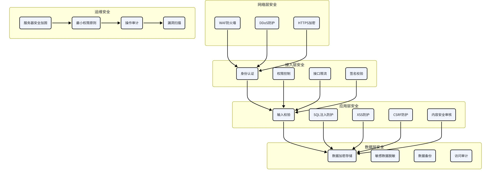

# 八、安全架构设计

## 8.1 安全架构总览

安全架构覆盖从网络层到应用层的全方位安全防护，保障系统和用户数据的安全。

## 8.2 认证与授权

### 8.2.1 认证方案

采用JWT（JSON Web Token）认证方案，无状态，便于水平扩展。

Token结构：

Access Token：访问令牌，有效期2小时，用于接口访问

Refresh Token：刷新令牌，有效期7天，用于刷新Access Token

认证流程：

用户登录成功，返回Access Token和Refresh Token

前端将Token存储在localStorage或内存中

每次请求在Header中携带Access Token

服务端校验Token有效性和签名

Access Token过期后，使用Refresh Token自动刷新

Refresh Token过期后，需要重新登录

### 8.2.2 登录方式

手机号验证码登录：短信验证码登录，简单便捷

微信授权登录：微信OAuth2.0授权登录，降低注册门槛

账号密码登录：传统用户名密码登录（可选）

### 8.2.3 权限控制

采用RBAC（基于角色的访问控制）权限模型。

角色划分：

普通用户：只能操作自己的数据

运营人员：可以管理基础数据、查看统计数据

管理员：拥有所有权限，可以管理用户、配置系统

权限控制粒度：

接口级：每个接口配置所需权限，无权限则拒绝访问

数据级：普通用户只能看到自己的数据，管理员可以看到所有数据

### 8.2.4 安全加固

密码加密：使用bcrypt或Argon2加密存储密码，不存储明文

验证码防刷：图形验证码 + 短信限流，防止恶意刷验证码

登录失败锁定：连续多次登录失败，临时锁定账号

异地登录提醒：异地登录时发送提醒通知

Token防泄露：HTTPS传输 + 短有效期 + 主动注销机制

## 8.3 数据安全

### 8.3.1 数据加密

传输加密：

全站HTTPS，使用TLS 1.3协议

配置HSTS，强制HTTPS访问

证书自动续期，防止过期

存储加密：

敏感字段加密存储，如手机号、身份证号

使用AES-256加密算法

密钥分开管理，不与数据存在一起

### 8.3.2 敏感数据脱敏

敏感数据在展示和日志中需要脱敏处理。

| 数据类型 | 脱敏规则 | 示例 |
| --- | --- | --- |
| 手机号 | 中间4位打码 | 138****1234 |
| 邮箱 | 用户名部分打码 | u***@example.com |
| 身份证号 | 中间10位打码 | 4201**********1234 |
| 姓名 | 只显示姓 | 张* |
| 地址 | 详细地址打码 | 武汉市洪山区*** |

### 8.3.3 数据备份与恢复

备份策略：每日全量备份 + 实时增量备份（WAL日志）

备份保留：日备份保留7天，周备份保留1个月，月备份保留1年

异地备份：重要数据备份到异地机房，防止机房级故障

恢复演练：定期进行恢复演练，验证备份可用性

### 8.3.4 数据访问审计

所有敏感数据的访问都有日志记录

记录操作人、操作时间、操作类型、数据范围

审计日志保留至少6个月

定期审计异常访问行为

### 8.3.5 隐私保护

遵循《个人信息保护法》等法律法规

用户数据最小化原则，只收集必要的信息

用户有权查看、导出、删除自己的数据

明确的隐私政策，告知用户数据用途

## 8.4 接口安全

### 8.4.1 输入校验

所有外部输入都必须进行严格校验，防止恶意输入。

参数校验：使用Pydantic校验参数类型、格式、长度、范围

SQL注入防护：使用ORM预编译SQL，禁止拼接SQL字符串

XSS防护：输出时对HTML特殊字符进行转义

CSRF防护：关键操作校验Referer或CSRF Token

### 8.4.2 接口限流

防止恶意请求刷接口，保护系统稳定性。

限流策略：

全局限流：整个系统的QPS上限，防止系统过载

用户级限流：每个用户的请求频率限制

IP级限流：每个IP的请求频率限制

接口级限流：不同接口设置不同的限流阈值

限流算法：令牌桶算法，平滑限流，允许突发流量。

### 8.4.3 签名校验

重要接口增加签名校验，防止请求被篡改。

签名规则：

将所有参数按字母排序

拼接成key=value&key=value格式

拼接app_secret

MD5或SHA256签名

请求头携带签名和时间戳

### 8.4.4 接口防重放

请求携带时间戳，超过有效期的请求拒绝

请求携带随机nonce，一段时间内的重复请求拒绝

重要操作需要二次确认

### 8.4.5 WAF防护

接入Web应用防火墙，拦截常见的Web攻击。

SQL注入攻击拦截

XSS攻击拦截

命令注入拦截

文件上传漏洞防护

目录遍历防护

DDoS攻击防护

## 8.5 内容安全

### 8.5.1 内容安全审核

用户生成的内容（UGC）必须经过安全审核，防止违规内容传播。

审核范围：

用户对话消息

用户分享的方案

用户评论和反馈

用户头像和昵称

审核方式：

机审：接入阿里云/腾讯云内容安全API，自动审核，实时拦截

人审：机审不确定的内容，进入人工审核队列

用户举报：用户可以举报违规内容，人工核实处理

### 8.5.2 文本内容安全

检测类型：

涉政敏感内容

色情低俗内容

暴力恐怖内容

广告引流内容

辱骂攻击内容

违法违规内容

处理策略：

确定违规：直接拦截，返回错误提示

疑似违规：先拦截，进入人工审核

正常内容：放行通过

### 8.5.3 图片内容安全

涉黄图片检测

涉政图片检测

暴力血腥图片检测

广告二维码检测

图片OCR文字检测

### 8.5.4 AI生成内容安全

大模型生成的内容也需要安全审核，防止生成违规内容。

输入审核：用户的提问先经过安全审核，防止诱导生成违规内容

输出审核：大模型生成的内容再经过一次安全审核

Prompt防护：系统Prompt加入安全约束，引导模型生成合规内容

敏感词过滤：对生成内容进行敏感词过滤和替换

### 8.5.5 数据合规

遵循《生成式人工智能服务管理暂行办法》

AI生成的内容标注「AI生成」

建立内容安全应急预案

定期进行安全合规审计
