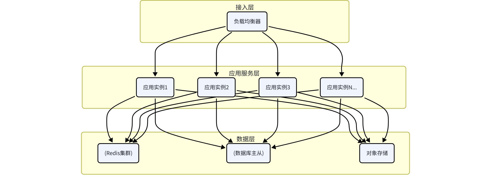
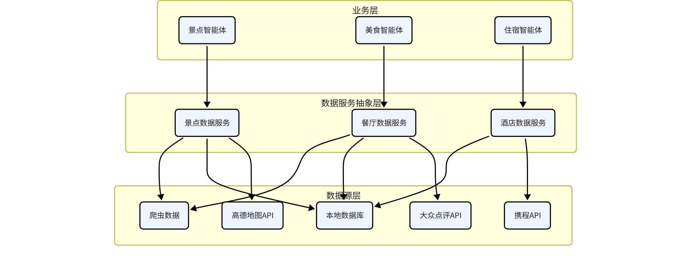

# 十、可扩展性设计

## 10.1 水平扩展设计

### 10.1.1 无状态设计

应用服务设计为完全无状态，支持水平扩展。

会话状态存储在Redis，不存储在应用进程内存中

用户数据存储在数据库，不存储在本地

文件存储在对象存储，不存储在本地磁盘

配置通过配置中心下发，不硬编码在代码中

好处：

随时可以增加或减少服务实例

实例故障不影响用户体验

发布升级可以滚动进行，不停机

### 10.1.2 水平扩展架构



### 10.1.3 自动扩缩容

根据系统负载自动调整实例数量。

扩容触发条件：

CPU使用率 > 70% 持续5分钟

内存使用率 > 80% 持续5分钟

接口平均响应时间 > 1秒 持续5分钟

请求队列堆积超过阈值

缩容触发条件：

CPU使用率 < 30% 持续30分钟

内存使用率 < 40% 持续30分钟

### 10.1.4 数据库扩展

第一阶段：单库 + 读写分离，支撑万级用户

第二阶段：垂直分库，按业务拆分，支撑十万级用户

第三阶段：水平分表 + 分库，支撑百万级用户

第四阶段：NewSQL数据库（如TiDB），支撑千万级用户

## 10.2 功能扩展设计

### 10.2.1 模块化设计

系统采用模块化设计，每个功能模块独立，松耦合，便于扩展。

按领域划分模块：用户模块、方案模块、对话模块、数据模块

模块间通过接口通信：不直接依赖内部实现，只依赖接口

独立部署和升级：每个模块可以独立部署、独立升级

### 10.2.2 插件化机制

核心功能支持插件化扩展，不修改核心代码就能增加新功能。

可扩展点：

新的智能体：以插件形式注册新的专业智能体

新的数据源：接入新的第三方数据服务

新的输出格式：支持导出为新的文件格式

新的登录方式：支持新的第三方登录

插件接口：

统一的插件注册接口

统一的生命周期管理

插件间隔离，互不影响

### 10.2.3 配置化设计

尽量通过配置实现功能，减少硬编码。

规则配置化：业务规则通过配置文件或配置中心管理

流程配置化：工作流、审批流等通过配置定义

文案配置化：前端文案、提示语等可配置

开关配置化：新功能通过特性开关控制灰度发布

### 10.2.4 API扩展

版本化API：API支持多版本并存，新版本不影响老版本

开放API：提供开放平台API，支持第三方接入

Webhook：支持事件回调，第三方可以订阅事件

### 10.2.5 前端扩展

组件化：UI组件化，可复用可组合

微前端：复杂场景下支持微前端架构，不同团队独立开发

主题系统：支持主题切换和自定义主题

## 10.3 智能体扩展机制

### 10.3.1 智能体注册机制

智能体采用注册制，新增智能体不需要修改核心代码。

智能体注册机制示例

```python
class AgentRegistry:
"""智能体注册中心"""

def __init__(self):
self._agents: Dict[str, BaseAgent] = {}

def register(self, agent: BaseAgent):
"""注册智能体"""
self._agents[agent.name] = agent

def get_agent(self, name: str) -> BaseAgent:
"""获取智能体"""
return self._agents.get(name)

def list_agents(self) -> List[str]:
"""获取所有智能体名称"""
return list(self._agents.keys())

# 注册方式1：装饰器
@agent_registry.register
class NewAgent(BaseAgent):
name = "new_agent"
description = "新的智能体"
...

# 注册方式2：配置文件
# agents.yaml
# - name: new_agent
#   module: app.agents.new_agent
#   class: NewAgent
```

### 10.3.2 智能体标准接口

所有智能体遵循统一的接口规范，保证可替换、可扩展。

统一的输入格式：PlanContext上下文

统一的输出格式：标准化字典

统一的生命周期：初始化 → 执行 → 校验 → 返回

统一的错误处理：异常捕获、重试、降级

### 10.3.3 工作流可配置

智能体的执行顺序和依赖关系通过配置定义，不硬编码。

```yaml
工作流配置示例workflow:
name: travel_planning
steps:
- name: info_collection
agent: user_interaction_agent
type: serial

- name: parallel_planning
type: parallel
steps:
- name: attraction_planning
agent: attraction_agent
- name: food_planning
agent: food_agent
- name: hotel_planning
agent: hotel_agent
- name: weather_adaptation
agent: weather_agent

- name: route_optimization
agent: route_optimization_agent
type: serial
depends_on: [parallel_planning]

- name: budget_calculation
agent: budget_agent
type: serial
depends_on: [route_optimization]

- name: plan_integration
agent: plan_integrator_agent
type: serial
depends_on: [budget_calculation]
```

### 10.3.4 工具扩展机制

智能体使用的工具也支持扩展，新增工具不需要修改智能体代码。

工具统一封装为标准格式

智能体通过名称调用工具

工具可以在不同智能体间复用

支持工具权限控制，不同智能体可用的工具不同

## 10.4 数据源扩展设计

### 10.4.1 数据服务抽象层

在业务层和数据源之间增加数据服务抽象层，屏蔽底层数据源差异。



### 10.4.2 多数据源融合

支持多个数据源，自动融合，提高数据质量和覆盖度。

主数据源：数据质量最好、最稳定的数据源

补充数据源：补充主数据源没有覆盖的数据

备选数据源：主数据源故障时自动切换

融合策略：

优先级策略：高优先级数据源覆盖低优先级

补全策略：主数据源没有的字段，用其他数据源补全

校验策略：多个数据源对比，校验数据准确性

### 10.4.3 新增数据源流程

新增数据源只需要实现标准接口，不需要修改业务代码。

实现数据源适配器，遵循统一的接口规范

配置数据源优先级和权重

注册到数据服务工厂

配置数据同步任务

数据质量验证

### 10.4.4 数据适配器模式

数据适配器示例

```python
class BaseAttractionProvider(ABC):
"""景点数据提供者基类"""

@abstractmethod
def get_attractions(self, city: str, **kwargs) -> List[Attraction]:
"""获取城市景点列表"""
pass

@abstractmethod
def get_attraction_detail(self, attraction_id: str) -> Attraction:
"""获取景点详情"""
pass

class AmapAttractionProvider(BaseAttractionProvider):
"""高德地图景点数据提供者"""
...

class DianpingAttractionProvider(BaseAttractionProvider):
"""大众点评景点数据提供者"""
...

class AttractionService:
"""景点数据服务"""

def __init__(self):
self.providers: List[BaseAttractionProvider] = []

def add_provider(self, provider: BaseAttractionProvider, priority: int = 0):
"""添加数据提供者"""
self.providers.append((priority, provider))
self.providers.sort(key=lambda x: x[0], reverse=True)

def get_attractions(self, city: str, **kwargs) -> List[Attraction]:
"""获取景点列表，自动融合多个数据源"""
all_attractions = {}
for _, provider in self.providers:
try:
attractions = provider.get_attractions(city, **kwargs)
for attr in attractions:
if attr.id not in all_attractions:
all_attractions[attr.id] = attr
else:
# 合并补全字段
all_attractions[attr.id].merge(attr)
except Exception as e:
# 单个数据源失败不影响整体
logger.warning(f"Provider {provider} failed: {e}")

return list(all_attractions.values())
```

### 10.4.5 城市扩展

支持快速扩展新城市的数据覆盖。

热门城市优先：先覆盖热门旅游城市，逐步扩展

自动化采集：新城市数据可以通过自动化脚本批量采集

人工运营：重要城市的数据经过人工审核优化

用户贡献：支持用户补充和纠错数据
