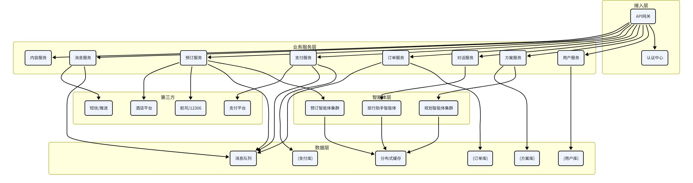

# 十二、V2.0架构演进规划

## 12.1 V1.0到V2.0的架构变化

### 12.1.1 V1.0与V2.0的核心差异

| 维度 | V1.0 | V2.0 |
| --- | --- | --- |
| 核心能力 | 方案规划 | 方案规划 + 执行预订 |
| 交互模式 | 一次性生成方案 | 全旅程陪伴式服务 |
| 数据复杂度 | 查询类数据 | 查询 + 交易 + 订单数据 |
| 系统复杂度 | 中等 | 高 |
| 安全要求 | 数据安全 | 数据安全 + 支付安全 |
| 并发要求 | 中等 | 高（秒杀、抢票等场景） |
| 架构模式 | 模块化单体 | 微服务架构 |

### 12.1.2 V2.0新增核心能力

票务预订：机票、火车票、景点门票的在线预订

酒店预订：酒店在线预订、支付、取消

餐厅预订：餐厅在线预订、排队取号

实时提醒：行程提醒、出发提醒、值机提醒

动态调整：行程中遇到问题自动调整方案

旅行助手：旅行途中的问答、导航、翻译等服务

订单管理：统一的订单中心，管理所有预订

支付系统：支持多种支付方式

### 12.1.3 架构演进路线

采用渐进式演进，不一次性重构，逐步从单体过渡到微服务。

第一阶段：V1.0模块化单体，打好架构基础

第二阶段：新增预订等V2.0功能，独立成服务，通过API与主服务通信

第三阶段：核心模块逐步拆分，用户服务、方案服务、订单服务独立部署

第四阶段：全面微服务化，引入服务网格、API网关等基础设施

### 12.1.4 V2.0架构总览



## 12.2 预订系统架构

### 12.2.1 预订系统架构

预订系统是V2.0的核心新增模块，负责各类产品的查询、预订、取消等操作。

### 12.2.2 预订服务分层

接入层：统一的预订API，对外提供标准接口

编排层：预订流程编排，状态机管理

渠道层：各供应商渠道适配器，屏蔽差异

基础层：订单、库存、价格等基础服务

### 12.2.3 预订类型

| 预订类型 | 特点 | 复杂度 |
| --- | --- | --- |
| 景点门票 | 即时确认、库存充足、退改简单 | 低 |
| 酒店预订 | 房态实时变化、价格波动、退改规则复杂 | 中 |
| 餐厅预订 | 时段库存、需要确认、取消有违约金 | 中 |
| 火车票 | 库存紧张、抢票场景、退改规则严格 | 高 |
| 机票 | 价格波动大、舱位复杂、退改费用高 | 高 |

### 12.2.4 订单状态机

每个订单都有明确的状态流转。

待支付：创建订单，等待用户支付

支付中：支付处理中

待确认：支付成功，等待供应商确认

已确认：预订成功

待出行：未到使用时间

使用中：正在使用

已完成：使用完成

取消中：取消申请处理中

已取消：取消成功

已退款：退款完成

已失败：预订失败

### 12.2.5 渠道适配模式

不同供应商的接口差异很大，通过适配器模式统一封装。

渠道适配器示例

```python
class BaseBookingProvider(ABC):
"""预订渠道基类"""

@abstractmethod
def search(self, params: Dict) -> List[Product]:
"""搜索产品"""
pass

@abstractmethod
def check_availability(self, product_id: str, date: str) -> bool:
"""检查库存"""
pass

@abstractmethod
def create_order(self, order_info: Dict) -> Order:
"""创建订单"""
pass

@abstractmethod
def cancel_order(self, order_id: str) -> bool:
"""取消订单"""
pass

@abstractmethod
def get_order_status(self, order_id: str) -> str:
"""查询订单状态"""
pass

class CtripHotelProvider(BaseBookingProvider):
"""携程酒店渠道"""
...

class QunarHotelProvider(BaseBookingProvider):
"""去哪儿酒店渠道"""
...

class BookingService:
"""预订服务"""

def __init__(self):
self.providers: Dict[str, BaseBookingProvider] = {}

def register_provider(self, type: str, provider: BaseBookingProvider):
self.providers[type] = provider

def create_order(self, type: str, order_info: Dict) -> Order:
provider = self.providers.get(type)
if not provider:
raise ValueError(f"Unsupported booking type: {type}")
return provider.create_order(order_info)
```

### 12.2.6 库存与价格

库存管理：实时库存查询 + 预占库存机制

价格管理：多渠道比价、动态价格、促销价格

防超卖：分布式锁 + 库存校验，防止超卖

价格保护：下单后价格变动的处理策略

## 12.3 支付系统接入

### 12.3.1 支付系统架构

支付系统是V2.0的核心基础设施，需要高安全、高可用、高一致性。

### 12.3.2 支付方式

微信支付

支付宝

银联支付

余额支付（可选）

### 12.3.3 支付流程

创建支付订单

选择支付方式

调起支付

用户支付

支付结果回调

更新订单状态

发货/确认

### 12.3.4 支付安全

签名校验：所有支付请求和回调都进行签名校验

金额校验：回调金额与订单金额比对，防止篡改

幂等设计：支付回调保证幂等，重复通知不重复处理

风控系统：异常交易检测和拦截

数据加密：敏感支付数据加密存储

### 12.3.5 对账系统

自动对账：每日自动与支付渠道对账

差错处理：对账差异自动处理或人工介入

资金结算：定期与渠道结算资金

财务报表：生成财务报表和统计数据

### 12.3.6 退款系统

支持全额退款和部分退款

退款原路返回

退款状态跟踪

退款超时处理

## 12.4 实时消息推送

### 12.4.1 消息推送架构

V2.0需要实时向用户推送行程提醒、订单状态变化等消息。

### 12.4.2 推送渠道

| 渠道 | 适用场景 | 实时性 |
| --- | --- | --- |
| APP推送 | 重要通知、实时提醒 | 高 |
| 小程序订阅消息 | 行程提醒、订单通知 | 中 |
| 短信 | 重要提醒、验证码 | 高 |
| 邮件 | 订单详情、行程单 | 低 |
| 站内信 | 系统通知、活动消息 | 中 |

### 12.4.3 提醒类型

行程出发提醒：出发前一天、出发前几小时提醒

值机提醒：航班值机时间提醒

入住提醒：酒店入住时间提醒

景点预约提醒：需要预约的景点提醒

天气变化提醒：目的地天气突变提醒

订单状态变更：预订成功、取消成功等通知

行程变更提醒：航班延误、取消等紧急通知

### 12.4.4 实时通信

WebSocket：对话消息、实时通知的实时推送

SSE：方案生成进度、订单状态等服务端推送

长连接：保持长连接，实时推送消息

### 12.4.5 定时任务

使用分布式定时任务调度系统，管理各种定时提醒。

支持Cron表达式配置

支持任务分片和分布式执行

支持任务失败重试

支持任务管理和监控

## 12.5 微服务拆分规划

### 12.5.1 微服务拆分原则

按业务领域拆分：每个服务对应一个业务领域

单一职责：每个服务只负责一件事

独立部署：每个服务可以独立部署和升级

数据独立：每个服务有自己的数据库，不直接访问其他服务的数据库

渐进式拆分：先拆变化快的、独立的模块，核心模块后拆

### 12.5.2 服务拆分规划

| 服务名称 | 职责 | 拆分阶段 |
| --- | --- | --- |
| 用户服务 | 用户注册、登录、信息、权限 | 第二阶段 |
| 方案服务 | 方案生成、查询、修改、导出 | 第二阶段 |
| 对话服务 | 对话交互、消息管理 | 第三阶段 |
| 订单服务 | 订单管理、状态流转 | 第二阶段 |
| 支付服务 | 支付、退款、对账 | 第二阶段 |
| 预订服务 | 酒店、门票、机票等预订 | 第三阶段 |
| 智能体服务 | 多智能体编排、规划执行 | 第三阶段 |
| 消息服务 | 短信、推送、站内信 | 第三阶段 |
| 内容服务 | 景点、餐厅、酒店等基础数据 | 第四阶段 |
| 搜索服务 | 全文检索、语义搜索 | 第四阶段 |

### 12.5.3 微服务基础设施

API网关：统一入口、路由、限流、鉴权

服务注册与发现：Nacos或Consul

配置中心：统一配置管理

服务网格：Istio（可选，后期引入）

分布式链路追踪：Jaeger或SkyWalking

消息队列：RabbitMQ或Kafka，服务间异步通信

分布式事务：Seata，保证跨服务数据一致性

### 12.5.4 服务间通信

同步调用：HTTP/gRPC，实时性要求高的场景

异步消息：消息队列，解耦、削峰、异步处理

事件驱动：事件总线，服务间通过事件解耦

### 12.5.5 数据一致性

微服务架构下，跨服务的数据一致性是难点。

最终一致性：大部分场景接受最终一致，不追求强一致

事件溯源：通过事件保证数据最终一致

Saga模式：长事务使用Saga模式，通过补偿操作保证一致性

TCC模式：强一致性要求高的场景使用TCC

### 12.5.6 演进路线总结

| 阶段 | 架构模式 | 核心工作 | 适用阶段 |
| --- | --- | --- | --- |
| 第一阶段 | 模块化单体 | 打好架构基础，模块内聚 | V1.0 |
| 第二阶段 | 单体 + 独立服务 | 新增功能独立成服务 | V2.0初期 |
| 第三阶段 | 核心服务拆分 | 核心业务服务化 | V2.0中期 |
| 第四阶段 | 全面微服务 | 全面微服务化 + 服务网格 | V2.0后期 |

> 架构演进建议：不要一开始就追求完美的微服务架构，先从单体做起，随着业务增长和团队扩大，逐步拆分。过早微服务化会增加复杂度，反而降低开发效率。

|（注：部分内容可能由 AI 生成）
